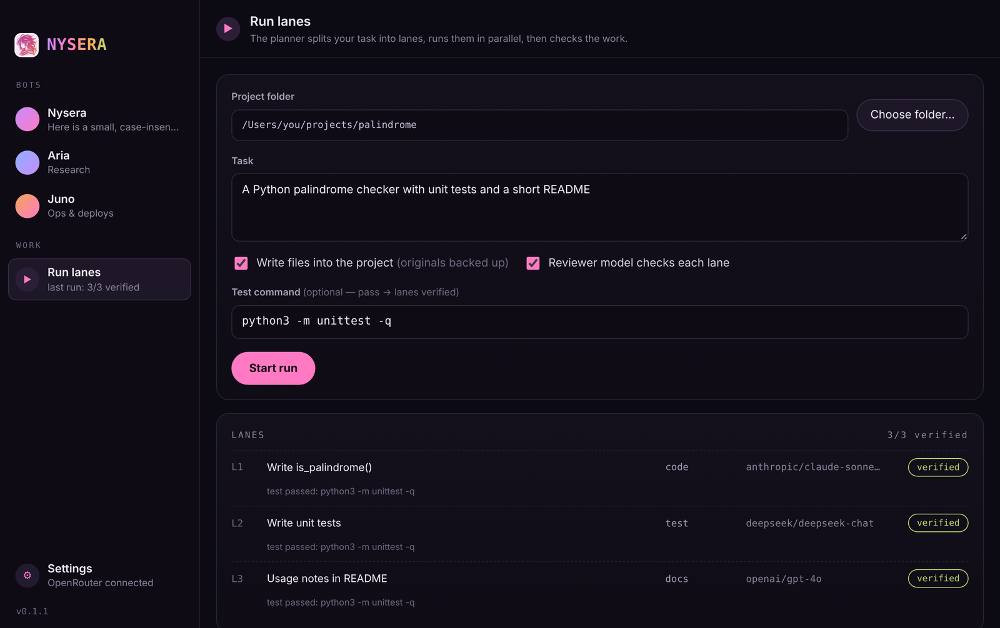
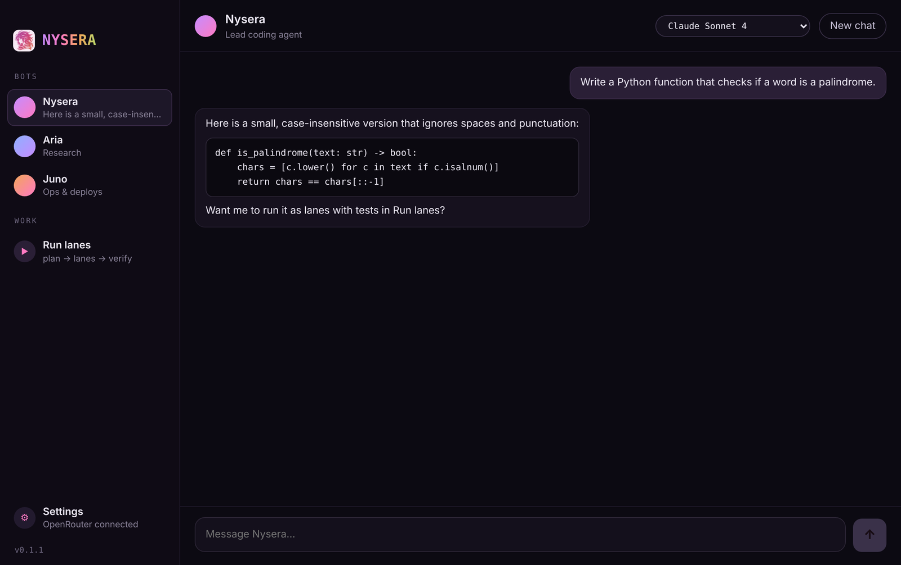

<div align="center">


# Nysera Desktop

**Your AI agents and multi-model lanes, in one window.**
Chat with Nysera, Aria and Juno, or hand a whole task to the crew and watch the lanes get verified.

[](https://github.com/nysera-dev/nysera-desktop/releases/latest)
[](https://github.com/nysera-dev/nysera-desktop/releases)
[](https://github.com/nysera-dev/nysera-desktop/actions)
[](LICENSE)

<a href="https://github.com/nysera-dev/nysera-desktop/releases/latest/download/Nysera-mac-arm64.dmg"></a>
<a href="https://github.com/nysera-dev/nysera-desktop/releases/latest/download/Nysera-Setup-win-x64.exe"></a>

[Website](https://nysera.app) · [CLI](https://github.com/nysera-dev/nysera) · [Releases](https://github.com/nysera-dev/nysera-desktop/releases)



</div>

---

## Features

- **Bots** — **Nysera** (lead coding agent), **Aria** (research) and **Juno** (ops & deploys). Pick any OpenRouter model per chat; replies stream in and history is kept.
- **Run lanes** — choose a project folder and describe a task. A planner splits it into lanes, lanes run in parallel on each category's model chain (with automatic fallback), and a lane is only **verified** when your test command passes or a reviewer model passes it. Same engine as the [`nysera` CLI](https://github.com/nysera-dev/nysera).
- **Safe writes** — files are only written into the project when you tick *Write files*, and originals are backed up into the run folder first.
- **Your key, your machine** — your OpenRouter key is stored locally, encrypted with your OS keychain when available. Model chains are shared with the CLI.
- **Always real** — every chat reply and every lane comes from a live model on your own OpenRouter key.



## First launch

The app is not code-signed yet, so your OS will warn you the first time:

| OS | What to do |
|---|---|
| macOS | Open the app once, then go to **System Settings → Privacy & Security → Open Anyway**. |
| Windows | On the blue SmartScreen screen, click **More info → Run anyway**. |

Then open **Settings** in the app and paste an [OpenRouter API key](https://openrouter.ai/settings/keys) to start.

## Develop

```bash
npm install
npm start
```

## Release

Bump `version` in `package.json` and push to `main`. GitHub Actions builds the macOS `.dmg` (Apple silicon, ad-hoc signed) and the Windows `.exe`, and publishes them as release `vX.Y.Z`. The download buttons above always point at the latest release.

## Contributing

Bug reports and ideas are welcome — see [CONTRIBUTING.md](CONTRIBUTING.md) and open an [issue](https://github.com/nysera-dev/nysera-desktop/issues/new/choose).

## License

[MIT](LICENSE)
